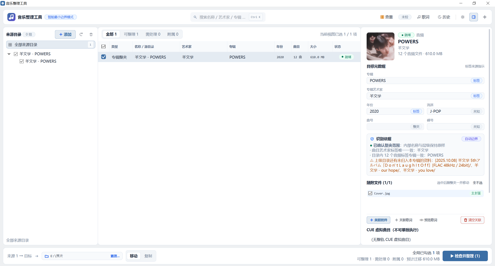
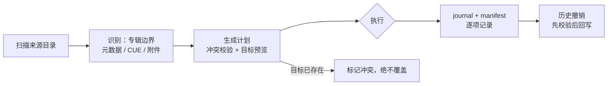

<p align="center">
  
</p>

<h1 align="center">音乐整理工具</h1>

<p align="center">
  <a href="LICENSE"></a>
  
  
  
  <!-- 推送到 GitHub 后可启用动态徽章(把下面的 lan1145143 换成你的用户名):
  <a href="../../releases"></a>
  <a href="../../releases"></a>
  -->
</p>

<p align="center">面向个人音乐库的中文桌面整理工具 —— 整夹归位、散曲改名、附件随行、查重隔离、全程可撤销。</p>

## 说明

技术栈：

- Python 3.11+ / PySide6（Widgets）
- mutagen（音频标签直读）· Pillow（封面处理）

已支持的平台：

- Windows 10 / 11 x64（免安装文件夹交付，无需安装 Python 或 Qt）

> [!IMPORTANT]
> **核心承诺：绝不覆盖任何文件。** 目标路径已存在同名文件/目录时，计划期标记冲突、
> 执行期二次复核，一律停止并报告——宁可跳过，绝不静默覆盖。

软件下载请查看 [Releases](../../releases)（下载 `音乐整理工具-windows-x64.zip`，解压后
打开文件夹双击 `音乐整理工具.exe` 即可）。

数据默认随程序存放（便携模式）：程序目录下的 `data/`；若该位置不可写，自动回退到
`%LOCALAPPDATA%\音乐整理工具\data` 并在界面明确提示。

## ✨ 功能特性

- **整夹原样** —— 完整抓轨专辑（CUE/整轨/多碟）只按 `艺术家/原目录名/` 归位，内部字节与层级不动
- **散曲重命名** —— 元数据直读（标题/艺术家/专辑/年份），模板 A/B 可选，音轨号补零位数可调
- **附件随行** —— 封面、扫描图、CUE、抓轨日志、外置歌词自动识别并随整夹移动；支持手动关联、歌词预览
- **查重隔离** —— 内容哈希 + 音频指纹双口径检测；重复副本**非破坏性隔离**到 `a重复歌曲` 目录（排序置顶、显眼待核查），绝不直接删除
- **压缩包归档** —— 原包整档（不解压、不改名、零外部依赖），分卷整组处理
- **可撤销** —— 每次执行写 journal + manifest，支持任意次历史撤销，撤销前先校验现场
- **跨盘安全** —— 先整组复制并校验 SHA-256，通过后才删除来源；中断可核对状态续行
- **现代三栏工作台** —— 来源树 / 条目表格 / 详情面板，全局搜索（Ctrl+K）、三主题（浅色/深色/纸墨）、自定义主题色与背景

## 🖼️ 界面预览

<p></p>
<p align="center"><em>主界面：左侧来源树，中间条目列表（勾选即整理），右侧详情面板（识别依据透明可查），底部输出目录与执行</em></p>

## 🚀 快速开始（普通用户）

1. 到 [Releases](../../releases) 下载 `音乐整理工具-windows-x64.zip`
2. 解压，打开 `音乐整理工具` 文件夹，双击 **`音乐整理工具.exe`**
3. 左侧 **添加** 来源目录 → 核对勾选与目标元数据 → 选择输出目录 → **检查并整理**

## 🛠️ 从源码运行（开发者）

```powershell
# Windows 10/11，Python 3.11+
pip install -r requirements.txt
python -m app.main          # 或 python run.py
```

开发依赖（测试与打包）：

```powershell
pip install -r requirements-dev.txt
```

### 测试

```powershell
pytest tests -q             # 253 项单元测试
```

> [!NOTE]
> 系统 PATH 里的 `python` 若是 Microsoft Store 占位符（WindowsApps 假壳），
> 请改用真实 Python 环境（如 `uv venv` 创建）。

### 打包

```powershell
pyinstaller packaging/music_organizer.spec
# 产物：packaging/dist/音乐整理工具/（onedir 模式，双击其中 exe 即可运行）
```

## ⚙️ 工作原理



- **识别**：目录结构、CUE 实际引用、音频标签三方互证确定专辑边界；依据全部展示在详情面板
- **计划**：只为勾选项生成，逐项给出目标路径与提醒/阻止原因
- **执行**：先记录后操作；同盘移动、跨盘复制+校验；中断后状态可核对
- **撤销**：按历史记录逆向回滚，目标被改动时拒绝执行

## ❓ 常见问题

<details>
<summary><b>数据（设置/历史/状态）存在哪里？</b></summary>

便携模式下在程序目录 `data/` 中；该位置不可写时自动回退到
`%LOCALAPPDATA%\音乐整理工具\data`，界面会明确提示当前使用的目录。
</details>

<details>
<summary><b>目标目录已有同名文件，会不会被覆盖？</b></summary>

不会。计划期即检测并标记冲突；从计划到执行之间目标若被外部改动，执行层会再次复核，
存在即停止并报告，宁可跳过也不自动改名或覆盖。
</details>

<details>
<summary><b>为什么压缩包不解压？</b></summary>

设计取舍：解压意味着额外引擎依赖与误操作风险。工具一律将压缩包按原包归档到
`原始压缩包` 目录（分卷整组），保持零外部依赖，也符合"不动不认识的字节"原则。
</details>

<details>
<summary><b>整理错了还能恢复吗？</b></summary>

能。每次执行都写 journal + manifest，历史对话框支持对任意一次运行执行撤销；
撤销前会先校验目标现场（文件被修改过则拒绝），避免二次破坏。
</details>

<details>
<summary><b>杀毒软件报毒？</b></summary>

PyInstaller 免签名程序偶发误报，属常见现象。可自行校验后加入白名单，或从源码运行/自行打包。
</details>

## 🤝 参与贡献

欢迎 Issue 与 PR。为便于合并：

- 新功能建议先开 Issue 讨论必要性；
- Bug 修复请附重现方式与修复说明；
- 提交前跑通全量测试：`pytest tests -q`。

## ⚠️ 免责声明

本工具以"原样"提供，作者不对使用过程中造成的任何数据损失承担责任。整理前请确认
目标目录与勾选范围；重要资料请自行备份。

## 📄 许可证

本项目基于 [GPL-3.0](LICENSE) 许可证发行。

第三方组件：[PySide6](https://www.qt.io/)（LGPL-3.0）·
[mutagen](https://mutagen.readthedocs.io/)（GPL-2.0+）·
[Pillow](https://python-pillow.org/)（MIT-CMU）
